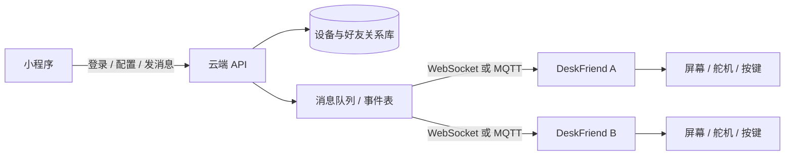

# DeskFriend 电子桌面机器人设计文档

**文档版本：** 0.1  
**日期：** 2026-10-31  
**状态：** 方案草案，供机械、硬件、固件和小程序共同评审

## 1. 项目概述

DeskFriend 是一款放在桌面上的双轴云台机器人。它用一个圆形显示屏表现表情和状态，用两个舵机实现左右转头和上下点头，用头部下压动作作为一个有触感的确认键。用户可以在机器人上完成一次轻量操作，例如“给朋友发送一个笑脸”或“问候朋友”，消息经过云端中继后同步到朋友的 DeskFriend 上。

产品的核心不是复杂的聊天能力，而是把“我想起你了”变成一个低打扰、可感知的实体动作：按下自己的机器人，朋友的机器人出现表情、动作和可选的短句反馈。

## 2. 现有资产与已知依据

工作区中已有以下资产，后续开发应优先复用：

| 资产 | 位置 | 在本方案中的用途 |
|---|---|---|
| 圆屏开发板资料和示例 | `Docs/Waveshare-ESP32-S3-LCD-1.28` | 屏幕驱动、引脚和固件验证 |
| 机械装配和零件模型 | `Mechanical/DeskFriend_V0.0.1` | 头部、机身、底座及器件干涉检查 |
| SG90 / SG90S 模型 | `Mechanical/DeskFriend_V0.0.1/Elecs/SG90` | 双轴云台初版选型和装配空间检查 |
| XIAO ESP32-S3 / Sense 模型 | `Mechanical/DeskFriend_V0.0.1/Elecs/Seeed` | 主控候选和结构占位 |
| 微信小程序示例工程 | `MiniProgram/DeskFriend` | 配网、绑定、云函数和页面开发起点 |
| 产品参考图 | `Mechanical/Reference` | 外观语言和交互姿态参考 |

项目资料中的 TFT_eSPI 配置 `Setup207_GC9A01.h` 明确给出了 GC9A01、240 x 240、SPI 引脚和背光引脚定义。本设计把这些配置作为当前开发基线，但量产板卡仍需按实际丝印和原理图复核。资料没有完整给出电源、舵机供电和外壳按压结构的最终规格，这些项目列入待验证清单。

## 3. 产品目标与边界

### 3.1 MVP 目标

1. 机器人能稳定显示基础表情、连接状态和收到的问候。
2. 头部下压可被可靠检测，并触发当前绑定的快捷动作。
3. 两个 SG90 类舵机能完成平滑的左右转头、上下点头和回中。
4. 小程序能完成首次配网、设备绑定、朋友配对、快捷动作配置和固件状态查看。
5. 两台机器人之间能通过云端可靠传递一条短消息或表情事件，并在离线后补发。

### 3.2 暂不纳入 MVP

- 语音识别、麦克风和扬声器通话。
- 摄像头、人脸识别和环境感知。
- 自由文本在屏幕上的长篇显示。
- 多自由度手臂和复杂连续动作编排。
- 需要手机持续在场的蓝牙实时遥控。

## 4. 用户与关键场景

### 场景 A：首次使用

用户打开小程序，扫描机器人二维码，进入配网模式。小程序通过蓝牙近场配置 Wi-Fi；设备联网后向云端注册，用户设置昵称和默认表情。

### 场景 B：发送问候

用户按下头部。机器人短暂显示“准备发送”，头部轻点确认，云端把快捷动作事件投递给朋友的设备。朋友设备收到后转向发送方预设方向，显示表情并做一次点头。

### 场景 C：配置快捷键

用户在小程序中选择朋友、消息类型、表情、动作和是否附带文字，将其保存为“轻按一次”的默认动作。可选地配置长按或连续两次按压为第二、第三动作。

### 场景 D：离线恢复

设备暂时断网时，屏幕显示离线状态，动作先写入本地发送队列。重新联网后按时间顺序补发，超过有效期的事件标记为过期，不向朋友重复打扰。

## 5. 产品形态与机械方案

### 5.1 结构分层

```text
        ┌────────────────────────────┐
        │ 头部：圆形显示屏 + 面壳       │
        │ 头部内部：下压导向、回弹件、按键 │
        └──────────────┬─────────────┘
                       │ 俯仰轴
                 ┌─────┴─────┐
                 │ 双轴云台支架 │  ← 俯仰舵机
                 └─────┬─────┘
                       │ 偏航轴
             ┌─────────┴─────────┐
             │ 机身 / 主控 / 配电   │
             └─────────┬─────────┘
                       │
             ┌─────────┴─────────┐
             │ 底座 / 防滑脚 / USB │
             └───────────────────┘
```

### 5.2 头部按压机构

- 头部整体沿垂直方向有 1.5 至 3.0 mm 的可控行程，具体数值通过样机手感测试确定。
- 使用微动开关或低行程轻触开关作为电气检测件，设置独立机械限位，避免开关承受过载。
- 采用弹簧或弹性体回弹，要求连续按压 10,000 次后仍能回位；MVP 先以 1,000 次寿命作为工程门槛。
- 头部下压不得直接把力传递给屏幕玻璃、排线或舵机齿轮。建议在头部壳体与云台之间增加导向柱和受力框架。
- 固件使用 20 至 40 ms 消抖，并区分短按、长按和双击；长按阈值初始设为 600 ms，双击窗口初始设为 350 ms。

### 5.3 双自由度云台

- 偏航轴：左右转头，建议工作范围为 -45° 至 +45°。
- 俯仰轴：上下点头，建议工作范围为 -25° 至 +25°。
- 两轴默认回中位置均为 0°，上电先以低速回中，再进入工作态。
- 机械限位优先于软件限位；舵机安装位置需在 CAD 中验证齿轮、线缆和头部按压机构不干涉。
- SG90 适合原型验证，量产前需要按头部质量、偏心距、启动电流和噪声重新核算扭矩。若负载超过 SG90 稳定范围，改用金属齿或更高扭矩的 9 g 舵机。

### 5.4 外观与可维护性

- 头部正面保持圆屏视觉中心，外壳采用圆角矩形或近似圆角方形，与参考图一致。
- 底座应提供防滑脚，并预留 USB-C 供电、复位/配网按键和状态指示灯的可触达位置。
- 头部与机身使用可拆连接，至少允许更换屏幕、舵机和按压开关，不建议一次性胶粘封装。
- 排线走线要留出两个轴的运动余量，避免转动时拉扯屏幕接口。

## 6. 硬件系统方案

### 6.1 推荐组成

| 模块 | 初版方案 | 说明 |
|---|---|---|
| 主控 | ESP32-S3（优先复用 XIAO ESP32-S3 或屏幕板载主控） | Wi-Fi、BLE 配网、OTA、动画渲染 |
| 显示 | Waveshare ESP32-S3-LCD-1.28，GC9A01，240 x 240 | 项目资料中的 `Setup207_GC9A01.h` 已有驱动配置 |
| 偏航舵机 | SG90 / SG90S | 通过独立 PWM 控制 |
| 俯仰舵机 | SG90 / SG90S | 通过独立 PWM 控制 |
| 按压检测 | 微动开关或轻触开关 | 连接 GPIO，使用上拉输入 |
| 状态指示 | 单色或 RGB LED | 配网、联网、异常和 OTA 状态 |
| 供电 | 5 V USB-C 输入，舵机独立稳压支路 | 逻辑电源和舵机电源分区，地线共地 |
| 可选存储 | ESP32 内部 NVS / LittleFS | 配置、离线队列和动画资源 |

### 6.2 电气设计原则

- 舵机启动和堵转会产生明显电流突变，不能直接从 MCU 3.3 V 供电。舵机支路建议使用 5 V 稳压和至少 470 至 1,000 uF 的低 ESR 储能电容，并在实测后确认余量。
- 屏幕和主控逻辑电源需与舵机噪声隔离；至少在舵机支路增加独立滤波和合理的地回流路径。
- 按键输入启用内部上拉，硬件上增加 RC 或 TVS 保护时需验证边沿速度和消抖策略。
- 所有 GPIO 分配必须避开 ESP32-S3 启动相关管脚，并在原理图中标出上电默认电平要求。
- USB-C 只承担供电和调试时，CC 电阻、ESD 和过流保护按 5 V Sink 设备实现；若需要 USB 数据，再单独评估接口和外壳开孔。

### 6.3 显示与引脚基线

项目已有 TFT_eSPI 配置给出以下显示接口基线：

| 信号 | GPIO |
|---|---:|
| MOSI | 11 |
| SCLK | 10 |
| CS | 9 |
| DC | 8 |
| RST | 12 |
| 背光 | 40 |

这些定义只代表当前示例工程的驱动配置，不能替代目标硬件原理图。若最终使用 XIAO ESP32-S3 外接屏幕，需重新确认电平、排针顺序、背光驱动和是否存在触摸控制器。

### 6.4 初版 GPIO 规划

以下只作为固件接口草案，具体 GPIO 需要结合最终主板和显示板复核：

| 功能 | 建议接口 | 备注 |
|---|---|---|
| 屏幕 SPI | 依照屏幕板实测配置 | 优先复用现有 TFT_eSPI 配置 |
| 偏航舵机 PWM | 可用 PWM GPIO A | 仅输出，不使用启动敏感脚 |
| 俯仰舵机 PWM | 可用 PWM GPIO B | 仅输出，不使用启动敏感脚 |
| 头部按压 | GPIO C | 上拉输入，中断或轮询均可 |
| 配网/复位键 | GPIO D | 长按进入配网 |
| 状态 LED | GPIO E 或 RGB LED 数据脚 | 固件抽象为状态指示器 |

## 7. 固件架构

### 7.1 分层

```text
应用层：快捷动作、表情、动作编排、消息队列
设备层：按键、舵机、显示、LED、音效（预留）
连接层：Wi-Fi、BLE 配网、MQTT/HTTPS/WebSocket 适配
系统层：NVS、LittleFS、OTA、看门狗、日志和故障恢复
```

建议使用 ESP-IDF 或 Arduino-ESP32 + FreeRTOS 任务。MVP 可以先用 Arduino 框架快速验证，但网络、动画和设备控制应通过清晰接口隔离，以便后续迁移。

### 7.2 主要任务

| 任务 | 责任 | 周期/触发 |
|---|---|---|
| InputTask | 按键采样、消抖、手势识别 | 5 至 10 ms |
| MotionTask | 舵机目标角度、缓动、限位和回中 | 20 ms |
| UiTask | 表情、状态、消息动画绘制 | 30 至 60 FPS 目标，按资源能力降级 |
| NetworkTask | 连接、心跳、事件收发、重连 | 事件驱动 + 周期心跳 |
| StorageTask | 配置和离线队列的持久化 | 事件驱动，批量写入 |
| OtaTask | 固件下载、校验、切换和回滚 | 用户触发或后台检查 |

### 7.3 设备状态机

```text
BOOT
  ├─ 无配置 → PROVISIONING
  └─ 有配置 → CONNECTING
CONNECTING
  ├─ 成功 → IDLE_ONLINE
  └─ 超时 → IDLE_OFFLINE
IDLE_ONLINE
  ├─ 本地按键 → SENDING
  ├─ 收到事件 → PLAYING
  ├─ 网络断开 → IDLE_OFFLINE
  └─ OTA → UPDATING
IDLE_OFFLINE
  ├─ 本地按键 → QUEUED
  └─ 重连成功 → IDLE_ONLINE
SENDING
  ├─ 已确认 → IDLE_ONLINE
  └─ 失败 → QUEUED
PLAYING → IDLE_ONLINE
QUEUED → 等待重连
UPDATING → 成功重启 / 失败回滚
```

### 7.4 表情与动作

表情资源使用轻量位图或参数化绘制，首批至少包含：待机、开心、害羞、疑问、伤心、发送中、收到消息、离线和错误。动作使用关键帧描述，不把角度写死在业务代码中：

```json
{
  "motionId": "nod_once",
  "frames": [
    {"t": 0, "yaw": 0, "pitch": 0},
    {"t": 180, "yaw": 0, "pitch": 16},
    {"t": 420, "yaw": 0, "pitch": -4},
    {"t": 700, "yaw": 0, "pitch": 0}
  ]
}
```

## 8. 连接与云端架构

### 8.1 组件关系



### 8.2 连接选择

- 配网：BLE 优先。手机发现设备后写入 Wi-Fi SSID、密码和一次性配网令牌；设备关闭配网广播并擦除敏感临时数据。
- 设备到云端：MVP 可使用 HTTPS 长轮询或 WebSocket；设备数量增加后建议 MQTT over TLS。
- 小程序到云端：优先复用现有微信云开发能力，使用云函数完成身份校验、设备绑定和消息写入。
- 设备身份：每台设备拥有唯一 `deviceId` 和设备密钥。绑定操作使用设备二维码中的短期 token，避免只凭可猜测的设备编号完成绑定。

### 8.3 事件协议草案

```json
{
  "eventId": "01J...",
  "type": "gesture.send",
  "senderDeviceId": "df_8f2c...",
  "receiverDeviceId": "df_91aa...",
  "presetId": "hello_wave",
  "payload": {
    "emoji": "smile",
    "text": "想你了",
    "motion": "nod_once"
  },
  "createdAt": "2026-10-31T12:00:00Z",
  "expiresAt": "2026-10-31T12:05:00Z",
  "sequence": 128
}
```

设备端必须实现：

- `eventId` 去重，重复投递不重复播放。
- 服务端确认和设备端确认两级 ACK。
- 时间过期和离线队列上限，例如最多保留 20 条或 24 小时。
- TLS 证书校验、设备密钥轮换和解绑后的凭证失效。
- 文本长度限制和可选内容过滤，MVP 屏幕端只显示 20 个汉字以内的短句。

### 8.4 数据模型

| 集合/表 | 核心字段 | 说明 |
|---|---|---|
| `users` | `userId`, `nickname`, `createdAt` | 微信用户与产品资料 |
| `devices` | `deviceId`, `ownerId`, `firmware`, `lastSeenAt`, `status` | 设备归属和在线状态 |
| `pairings` | `pairingId`, `userA`, `userB`, `deviceA`, `deviceB`, `status` | 朋友配对关系 |
| `presets` | `presetId`, `ownerId`, `receiverId`, `emoji`, `motion`, `text` | 快捷动作配置 |
| `events` | `eventId`, `sender`, `receiver`, `payload`, `state`, `expiresAt` | 消息事件和投递状态 |
| `device_configs` | `deviceId`, `brightness`, `volume`, `timezone`, `privacy` | 设备配置 |

## 9. 微信小程序方案

当前 `MiniProgram/DeskFriend` 是微信小程序示例工程，包含云开发、蓝牙、Wi-Fi、WebSocket 和文件上传等示例能力。产品化时应删去示例页，建立 DeskFriend 自己的页面和云函数边界。

### 9.1 页面结构

1. **首页**：显示设备头像、在线状态、今日收到的问候和“发送问候”入口。
2. **我的机器人**：设备列表、添加设备、设备昵称、固件版本、最后在线时间。
3. **绑定朋友**：扫描朋友码、确认配对、解除配对、关系权限。
4. **快捷动作**：选择朋友、表情、文字、动作和触发方式；提供发送测试。
5. **设备设置**：屏幕亮度、动作速度、夜间免打扰、离线队列、OTA 更新。
6. **配网向导**：进入配网、蓝牙发现、选择 Wi-Fi、连接验证、失败重试。

### 9.2 配网流程

```text
小程序登录
  → 扫描设备二维码
  → 设备进入 BLE 配网模式
  → 小程序写入临时 Wi-Fi 凭证
  → 设备联网并向云端注册
  → 小程序轮询/订阅注册结果
  → 用户设置昵称并完成绑定
```

如果目标手机系统对小程序 BLE 配网能力存在限制，应保留“设备临时热点 + 小程序引导系统 Wi-Fi 页面”的降级路径。配网凭证不得写入日志或云数据库明文。

### 9.3 交互原则

- 发送动作必须显示明确的朋友对象，避免误发。
- 本地按键触发的默认动作应可在小程序中关闭或改成“只在本地播放”。
- 解绑、清空队列和恢复出厂设置需要二次确认。
- 离线、投递失败、朋友未接受配对等状态都要给出可理解的反馈，而不是只显示“错误”。

## 10. 安全、隐私与可靠性

- 设备只存储运行所需的 Wi-Fi 凭证和设备令牌，恢复出厂时擦除。
- 云端按用户、设备和配对关系做权限校验，不能仅凭 `deviceId` 读取消息。
- 事件默认只包含短文本、表情和动作 ID，不上传摄像头、麦克风或位置数据。
- 所有远程消息采用 TLS；设备端验证服务端证书；固件使用签名校验和回滚分区。
- 头部按压和舵机运动需有机械限位。舵机异常、电源电压异常或看门狗复位后，设备进入安全姿态并停止连续运动。
- 连续失败重连使用退避策略，避免网络异常时快速耗尽电源和占满服务端连接。

## 11. 关键风险与验证计划

| 风险 | 影响 | 验证方法 | 通过条件 |
|---|---|---|---|
| 头部按压导致屏幕或舵机受力 | 结构损坏、误动作 | 装配样机做静态力和重复按压测试 | 受力路径独立，按压 1,000 次无卡滞 |
| SG90 扭矩不足或抖动 | 头部无法回中、噪声大 | 测头部质量、重心、启动电流和堵转电流 | 满载可稳定完成动作，温升可接受 |
| 舵机干扰屏幕和 Wi-Fi | 花屏、重启、掉线 | 同时执行双舵机动作并抓取电源波形 | 无复位、花屏或持续丢包 |
| BLE 配网兼容性 | 首次使用失败 | Android/iOS 多机型测试 | 主要机型一次成功率达到目标 |
| 云端重复投递 | 朋友收到重复动作 | 模拟断网、重连、重试和服务端重复消息 | 单个 `eventId` 最多播放一次 |
| OTA 失败 | 设备变砖 | 断电、断网、坏包、回滚测试 | 保留旧固件并自动恢复 |
| 小程序示例代码耦合 | 后期维护困难 | 先拆分产品页面、服务和示例页面 | 产品入口无示例页依赖 |

## 12. 分阶段实施计划

### P0：接口冻结与器件验证

- 确认最终主控组合：屏幕板载 ESP32-S3，还是 XIAO ESP32-S3 + 外接屏。
- 以现有模型完成屏幕、主控和两个 SG90 的装配干涉检查。
- 搭建电源实验板，测屏幕、主控和双舵机同时工作时的峰值电流。
- 定义按压开关位置、行程、回弹力和防误触逻辑。

### P1：单机原型

- 实现圆屏表情、Wi-Fi 连接、双舵机动作和头部按压识别。
- 固件实现本地快捷动作和离线状态。
- 小程序先完成设备列表、配网向导和基础配置。

### P2：双机消息闭环

- 实现设备注册、用户绑定、朋友配对、事件投递和 ACK。
- 完成发送方按压到接收方播放的端到端演示。
- 加入事件去重、过期、离线队列和解绑。

### P3：工程化与试用

- 完善外壳、云台、按压结构和线缆固定。
- 完成 OTA、日志、异常恢复和测试工具。
- 进行 5 至 10 台小批量试用，记录配网成功率、消息到达率、误触率和舵机噪声。

## 13. MVP 验收标准

1. 从冷启动到可用状态不超过 30 秒，首次配网在目标手机上可完成。
2. 头部短按 20 次，误触发率为 0；每次有效按压只产生一个事件。
3. 双舵机完成 100 次左右转头、点头和回中循环，无明显卡滞和失步。
4. 两台设备在正常网络下 5 秒内完成消息到达；断网恢复后事件按序补发且不重复。
5. 屏幕能显示至少 8 种状态/表情，并能在重启后恢复亮度、绑定和快捷动作配置。
6. OTA 失败时设备可回滚到上一版本，恢复出厂后不能继续访问原用户消息。
7. 小程序能完成：添加设备、配网、绑定朋友、编辑快捷动作、发送测试、解绑和查看固件版本。

## 14. 待确认问题

这些问题会影响器件、协议或交互，需要在 P0 结束时冻结：

1. 最终主控是使用 Waveshare 屏幕板载 ESP32-S3，还是 XIAO ESP32-S3 作为独立主控？
2. 机器人是否需要电池？若需要，容量、充电方式和可接受续航是多少？
3. 朋友配对是一对一为主，还是允许一个机器人绑定多个朋友？
4. 消息是否允许短文本，还是只发送预置表情和动作？
5. 头部下压是否只支持单击，还是需要长按、双击和方向/力度等扩展手势？
6. 是否需要声音反馈、震动或灯光？这些会改变电源和结构设计。
7. 云端是否继续使用当前微信云开发环境，还是建立独立后端以支持 MQTT 和设备规模化？
8. 目标外观尺寸、材料、打印工艺和成本上限是什么？

## 15. 下一步建议

建议先做一个“裸机闭环样机”：圆屏板 + 两个舵机 + 一个按键 + USB 供电，不等待最终外壳。先验证按压事件、双轴动作、云端投递和朋友端播放这条主链路，再根据测得的电流、扭矩、延迟和按压手感冻结机械尺寸与电源方案。完成这一步后，再把现有 `Mechanical/DeskFriend_V0.0.1` 模型和 `MiniProgram/DeskFriend` 工程逐步替换为产品化结构。
